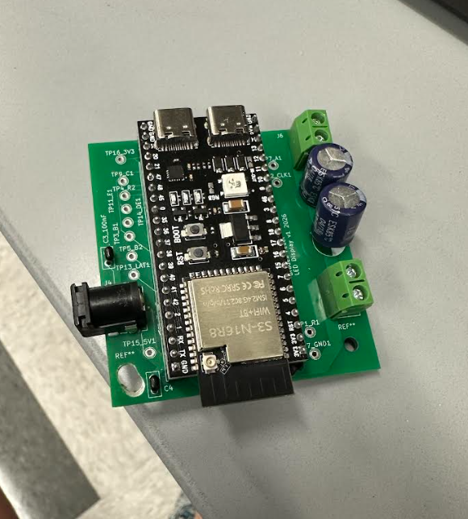

# ESP32-S3 LED Matrix — PCB Design & Bring-Up
**Braden Feuer · KiCad · ESP32-S3 · HUB75 · JLCPCB**

I designed, assembled, and brought up a custom carrier PCB for my Wi-Fi-connected 128×32 RGB desk display. The complete system is now working, including after replacing the capacitors I initially soldered onto the board to resolve ESP32 connectivity issues.

## What the board does

The board integrates ESP32 socket headers, a HUB75 output header, screw-terminal power connections, bulk capacitance, an optional barrel jack, and **17 labeled test points**. It connects an ESP32-S3 to two chained 64×32 RGB panels. The finished display shows a clock, weather, Spotify, tasks, and stock quotes.

I designed the PCB in KiCad, had it fabricated by JLCPCB, soldered the components, and debugged the assembled hardware.

## Design highlight: turn the harness into a board, keep it easy to debug

Rather than designing a new MCU board from scratch, I built a carrier around the ESP32 development board. The socketed module stays replaceable, while the panel interface and power connections become one compact assembly instead of a loose jumper-wire harness.

The **17 labeled test points** preserve convenient access to signals and power rails after assembly. That makes the wiring cleaner without losing the ability to probe the connections during bring-up.

The power interface also reflects a lesson from the prototype: a barrel connector failed under sustained panel current. I carried screw-terminal power connections into the PCB, so the barrel jack is not the only way to feed the board.

## Layout, render & schematic

Click an image to view the full-resolution version. These design images are hosted on my existing portfolio.

### KiCad layout

### 3D render before fabrication

### Schematic

## Hardware bring-up & debugging

The jumper-wire prototype had power-delivery problems and glitched pixels on fast HUB75 signals. Those issues motivated the move to a custom PCB.

After soldering the PCB, I encountered ESP32 connectivity issues. The board needed more capacitance, so I **swapped out the capacitors I had soldered onto it**. After replacing them, the connectivity issues were resolved and the complete display worked.

This project took me through the full cycle: prototype wiring, PCB design, fabrication, soldering, and hands-on debugging. The capacitor replacement was a useful reminder that board assembly is followed by validation and iteration.

## More project details

- [Display demo](https://bradenfeuer.github.io/assets/video/led-display-demo.mp4)
- [Full build story](https://bradenfeuer.github.io/projects/led-matrix-display.html)
- [Firmware source](https://github.com/bradenfeuer/led-matrix-display)
- [Résumé](https://bradenfeuer.github.io/assets/Braden-Feuer-Resume-current.pdf)

This repository documents the hardware project; firmware is linked above.
